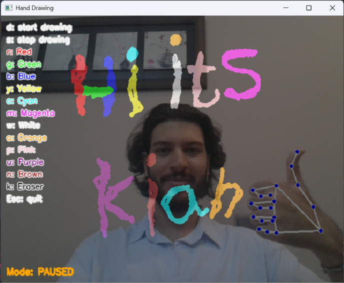
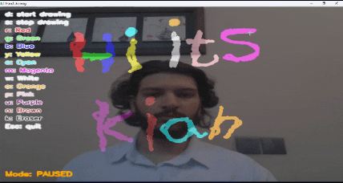

# Hand Drawing

Hand Drawing is a small real-time drawing project built with Python, OpenCV, and MediaPipe. It started with a simple idea: use the index finger as a pen, without needing to touch a screen.

With one hand in view, the app follows the index fingertip to make a freehand stroke. When both hands are visible, it draws a line between their index fingertips instead. The goal of this repository is to keep that interaction easy to try, while making the code and its behavior straightforward to follow.

## A look at the application

The image below shows the application window.



The animation demonstrates drawing and erasing with the two-hand interaction.



## What it can do

- Track up to two hands using MediaPipe.
- Draw a continuous stroke by moving one index fingertip.
- Draw a line between two index fingertips when both hands are in view.
- Switch between drawing colors, or use the eraser to remove strokes from the canvas.
- Pause and resume without accidentally connecting separate strokes.
- Keep the drawing-segment logic in a small, independently testable module.

## What you need

- Python 3.11 is used by the automated checks.
- A webcam.
- The packages listed in `requirements.txt`.

## Set up

Clone the repository and move into its directory:

```bash
git clone https://github.com/KianShojaei/Hand-Drawing.git
cd Hand-Drawing
```

A virtual environment is recommended so the project's packages stay separate from other Python projects:

```bash
python -m venv .venv
```

Activate it on Windows:

```powershell
.venv\\Scripts\\Activate.ps1
```

Or on macOS and Linux:

```bash
source .venv/bin/activate
```

Install the dependencies:

```bash
python -m pip install -r requirements.txt
```

## Run it

From the repository root, run:

```bash
python DrawTable/main.py
```

Allow webcam access if your operating system asks for permission. The app opens a window named **Hand Drawing**; press `Esc` in that window when you are ready to close it.

## Controls

| Key | Action |
| --- | --- |
| `d` | Start drawing |
| `s` | Pause drawing |
| `r` | Red |
| `g` | Green |
| `b` | Blue |
| `y` | Yellow |
| `c` | Cyan |
| `m` | Magenta |
| `w` | White |
| `o` | Orange |
| `p` | Pink |
| `u` | Purple |
| `n` | Brown |
| `k` | Eraser |
| `Esc` | Exit the application |

The selected color stays active until you choose another one. The eraser paints with the canvas background color, which clears the colored strokes along its path.

## How drawing behaves

- **One hand in view:** the app connects the index fingertip's position from one frame to the next, creating a freehand stroke.
- **Two hands in view:** the app draws a segment between the two index fingertips for each frame. Moving either hand changes the segment.
- **No hands in view:** the previous single-hand point is cleared. When a hand returns, it starts a fresh stroke rather than connecting to an old position.
- **Drawing paused:** the app stops adding new segments until drawing is started again.

These rules are handled by `DrawTable/drawing_logic.py`, separately from webcam capture and image rendering. Keeping this small piece independent makes it easier to test without a camera.

## Run the tests

From the repository root:

```bash
python -m unittest discover -s tests -v
```

The unit tests cover the single-hand stroke, the two-hand line, paused drawing, and transitions when hands enter or leave the frame. They test the drawing logic, not the webcam itself, so it is still worth trying the full application on your own machine.

The repository also includes a GitHub Actions workflow that runs the unit tests and checks Python syntax when changes are pushed to the relevant branches or a pull request targets `main`.

## Project structure

```text
Hand-Drawing/
├── .github/
│   └── workflows/
│       └── python-checks.yml
├── DrawTable/
│   ├── main.py
│   └── drawing_logic.py
├── Environment/
│   ├── environment.png
│   └── erasing.gif
├── tests/
│   └── test_drawing_logic.py
├── .gitignore
├── LICENSE
├── README.md
└── requirements.txt
```

## If something goes wrong

- **The webcam does not open:** close other apps that may be using it, then check your operating system's camera permissions.
- **The hand is not being tracked reliably:** improve the lighting, keep the hand inside the frame, and make sure the index fingertip is visible.
- **A package fails to install:** check the Python version in your active environment and consult the installation instructions for OpenCV or MediaPipe.

## License

This project is distributed under the MIT License. See [LICENSE](LICENSE) for the full terms.
